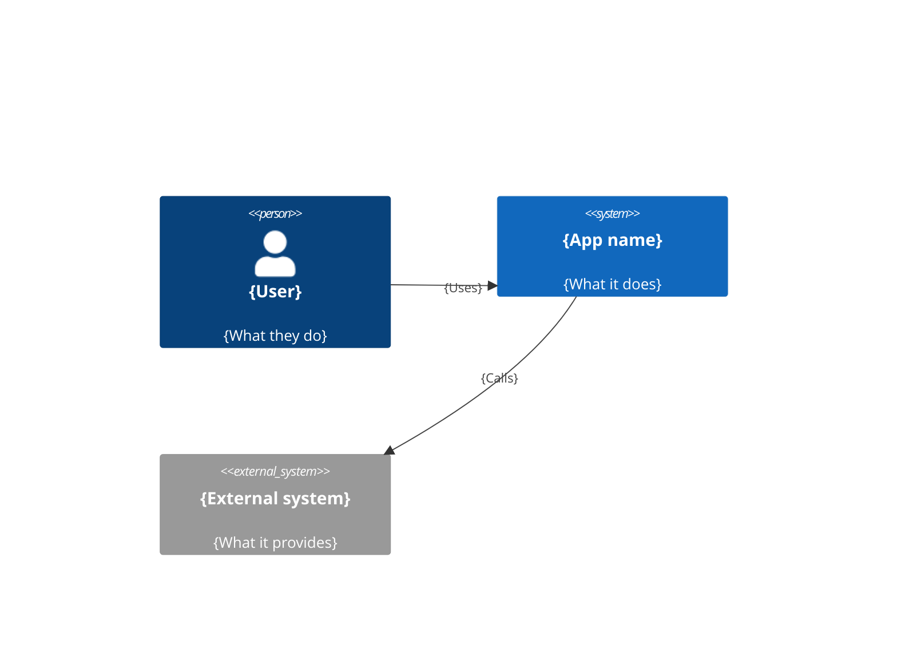
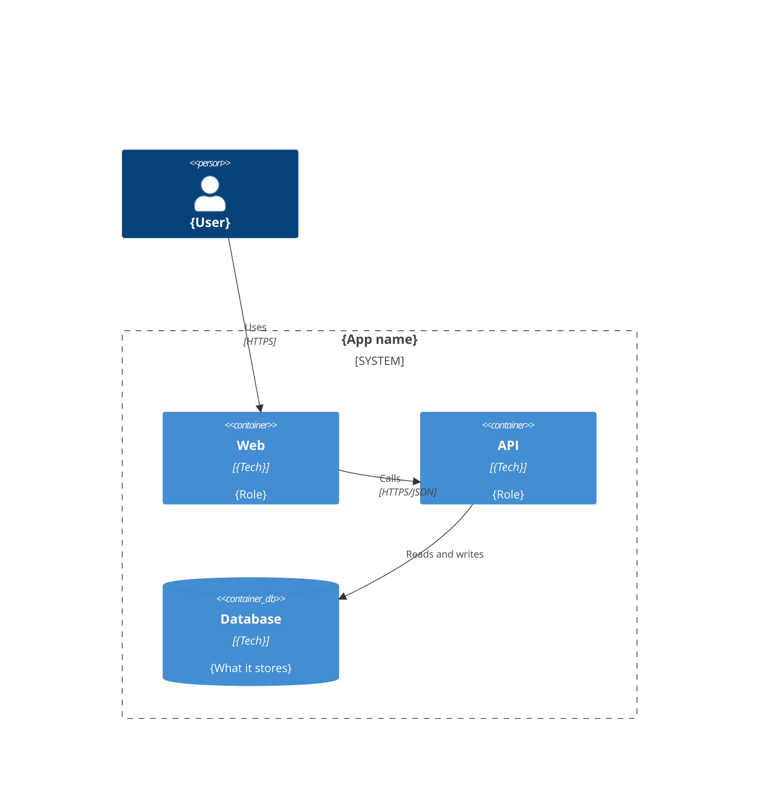

# Architecture

## The idea

{The architect's idea, in a few lines: how the project is built and why.}

## How the pieces fit together

{How the pieces fit together. The C4 model, levels 1 and 2, shows it visually.}

### System context (C4 level 1)

{Who uses the system and which external systems it talks to.}



### Containers (C4 level 2)

{The deployable parts (web, api, database, workers) and how they connect.}



## Main flows

### {Flow name}

1. {Step, 5-10 steps per flow.}

## Technologies

| Part | Technology | Why | ADR |
|---|---|---|---|
| {Frontend} | {Tech and version} | {Why it was chosen} | [NNNN](adr/NNNN-slug.md) |

The API contract lives in code (for example OpenAPI); link it here instead of copying it.

## Repository

{The project's actual folder tree, following the kit's project structure. One line per folder saying what it holds.}

```
apps/
  {app}/            {What this app is}
infra/
  bootstrap/        {Resources created once}
  modules/          {Reusable Terraform modules}
  environments/     {One folder per environment}
docs/               {Requirements, architecture, data model and ADRs}
```
