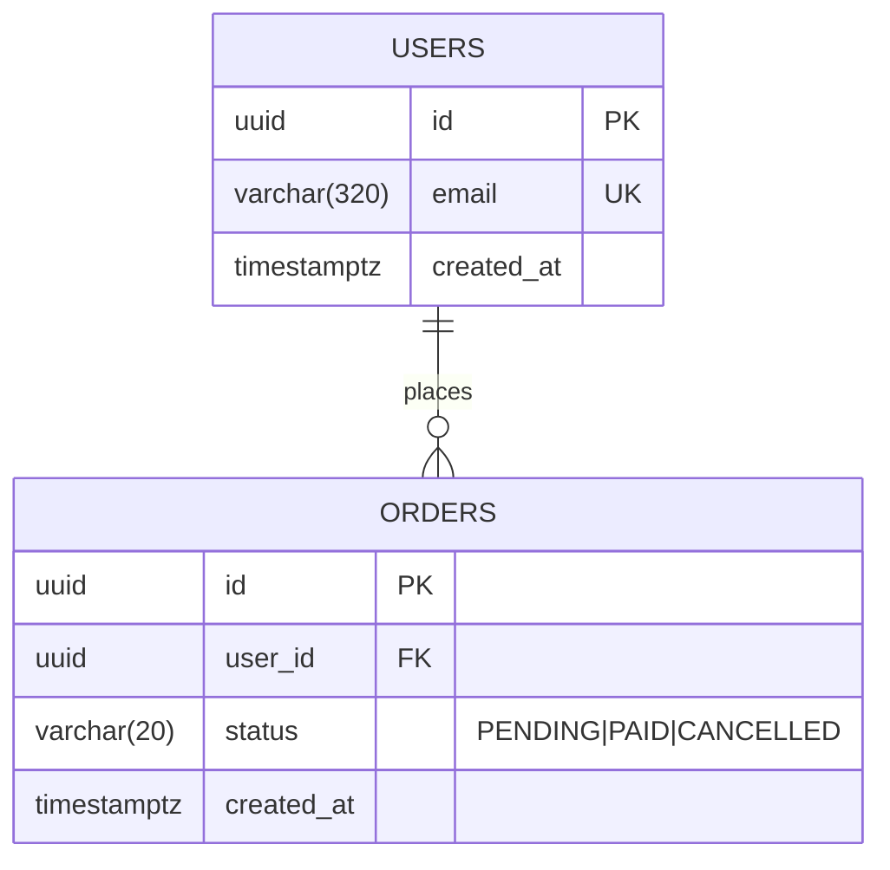

# Data model

## Entities

| Entity | Why it exists |
|--------|---------------|
| {ENTITY} | {What it stores and why the app needs it} |

<!--
Replace the example entities. Add one row per entity in the Entities table. Put constraints and allowed values in the attribute comment.
Add a short note under the diagram only for rules the diagram cannot show.
-->
